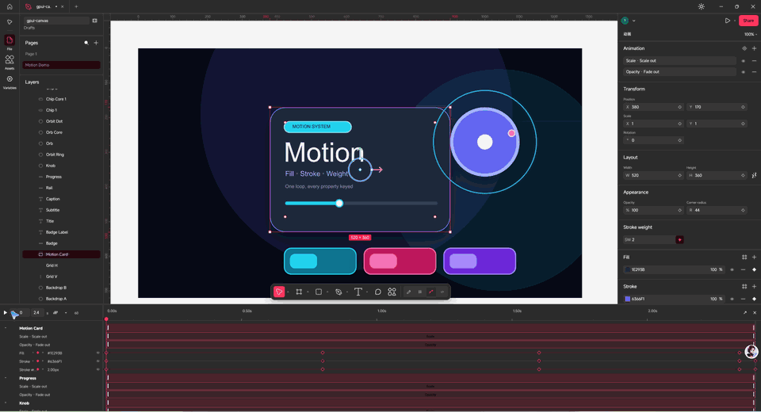
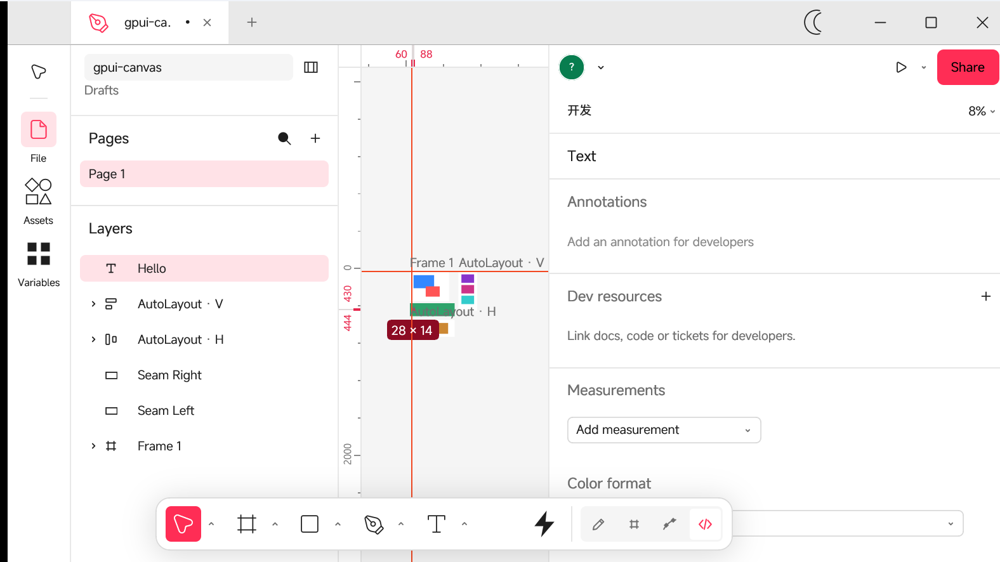
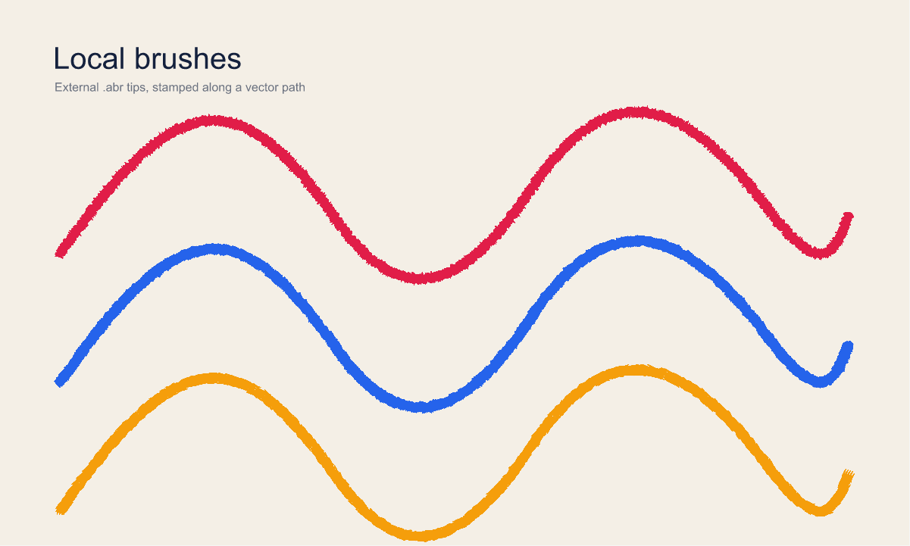
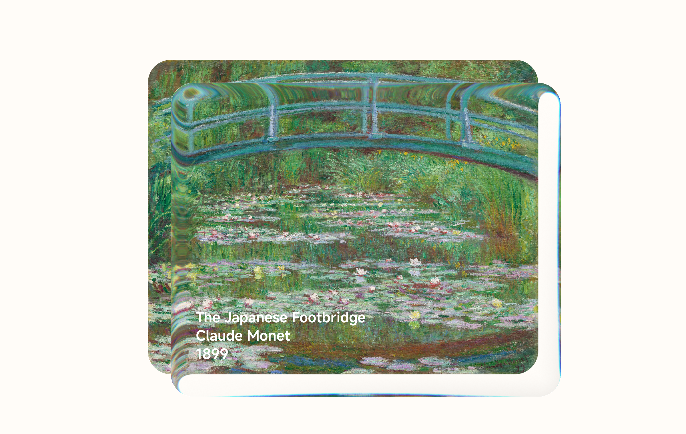

<p align="center">
  
</p>

<h1 align="center">Monet</h1>

<p align="center">
  <b>A native design tool front-end built with GPUI.</b><br>
  Frames, auto layout, components and variants, vector networks, styles, variables, prototypes<br>
  and a motion timeline — driven by a Rust document engine, in an app that opens offline.
</p>

<p align="center">
  <a href="README.md">English</a> · <a href="README.zh-CN.md">中文</a>
</p>

<p align="center">
  
  
  
  
  <br>
  <a href="https://sonarcloud.io/project/overview?id=MonetDesigns_Monet"></a>
  <a href="https://coderabbit.ai"></a>
</p>

<br>

> [!NOTE]
> **This is the GPUI front-end.** The document engine and the original egui front-end are developed
> in the upstream project, **[storytold/figcraft](https://github.com/storytold/figcraft)**. Engine
> changes belong upstream; this repository only accepts GPUI UI work. See
> [CONTRIBUTING.md](CONTRIBUTING.md).

<p align="center">
  <a href="#a-look-around">A look around</a> ·
  <a href="#what-this-is">What this is</a> ·
  <a href="#features">Features</a> ·
  <a href="#get-started">Get started</a> ·
  <a href="#contributing">Contributing</a>
</p>

<br>

<p align="center">
  <a href="docs/images/motion-hero.mp4"></a>
</p>
<p align="center"><sub><b>A 2.4 s Motion loop</b> — fill, stroke and stroke weight are keyed in the same timeline as the preset clips. <a href="docs/images/motion-hero.mp4">Watch the MP4</a> or <a href="docs/images/screenshots/08-motion-fill-stroke-weight.png">open the editor state</a>.</sub></p>

## A look around

All screenshots below are of the running GPUI application (`cargo run -p figcraft-ui-gpui --example run`).

<table>
<tr>
<td width="50%" valign="top">
  
  <p align="center"><sub><b>Design panel, light theme</b>: layers, canvas and auto layout properties</sub></p>
</td>
<td width="50%" valign="top">
  
  <p align="center"><sub><b>Dark theme</b>: the same document, themed interface</sub></p>
</td>
</tr>
<tr>
<td width="50%" valign="top">
  
  <p align="center"><sub><b>Assets</b>: components and styles library</sub></p>
</td>
<td width="50%" valign="top">
  
  <p align="center"><sub><b>Developer Mode</b>: inspect and hand-off controls</sub></p>
</td>
</tr>
<tr>
<td width="50%" valign="top">
  
  <p align="center"><sub><b>Motion</b>: auto-keyed fill, stroke and stroke weight</sub></p>
</td>
<td width="50%" valign="top">
  
  <p align="center"><sub><b>Variables</b>: collections and modes</sub></p>
</td>
</tr>
</table>

## What this is

Monet is a desktop design tool front-end. Its lower half is a document engine: a scene graph,
layout, vector networks, text, components, variables and prototypes. Its upper half is the
interface that draws and drives that engine.

The engine's original front-end was written with **egui**, an immediate-mode toolkit. This
repository ports that front-end to **GPUI**, the retained-mode, GPU-composited framework behind
Zed: a declarative element tree with persistent state, taffy layout, and panels, popovers and the
canvas composited as one scene on the GPU.

The port is intentionally one-for-one. Every panel, dialog, popover, menu and keyboard path is
rebuilt to match the egui front-end's layout, dimensions and behaviour, and
[`docs/gpui-egui-parity-plan.md`](docs/gpui-egui-parity-plan.md) tracks what still differs. The egui
front-end stays in the tree as the frozen reference the port is checked against; engine changes
are made upstream, not here.

## Features

<table>
  <tr>
    <td width="50%" valign="top">
      <h3>🎛️ One GPU scene</h3>
      Panels, popovers, the floating toolbar and the canvas share one render tree, so overlapping
      menus, drag previews and the motion timeline composite in the order you see on screen.
    </td>
    <td width="50%" valign="top">
      <h3>⚡ Smooth canvas</h3>
      Pan, zoom and selection stay responsive on large documents. Tiles are rasterised off the UI
      thread and streamed in, with a low-resolution overview first.
    </td>
  </tr>
  <tr>
    <td width="50%" valign="top">
      <h3>🧱 Engine-backed editing</h3>
      Auto layout, component instances and overrides, styles, variables and modes, boolean
      operations, vector networks, prototyping and boards all live in the engine, shared with the
      upstream project.
    </td>
    <td width="50%" valign="top">
      <h3>🎬 Motion, backed by the engine</h3>
      Keyframes, easing and per-property tracks drive the same scene the canvas draws. Fill,
      stroke and stroke weight auto-key from the inspector, presets cover enter/cycle/exit, and
      the timeline exports <b>MP4 (H.264)</b>, GIF, WebM (AV1) and a PNG sequence off the UI
      thread.
    </td>
  </tr>
  <tr>
    <td width="50%" valign="top">
      <h3>🖌️ Local brushes</h3>
      Brushes are external <code>.abr</code> files imported into a local library; strokes keep the
      brush tip's soft edge and are stamped along the path.
    </td>
    <td width="50%" valign="top">
      <h3>🧪 External WGSL materials</h3>
      Point a layer at a <code>.wgsl</code> file, or scan a folder with
      <code>FIGCRAFT_WGSL_DIR</code>. The shader runs as an offscreen pass over the canvas tile
      with the layer's pixels as input; its uniforms appear as labelled fields in the Effects
      panel, and bindings travel inside the document.
    </td>
  </tr>
  <tr>
    <td width="50%" valign="top">
      <h3>🔒 Offline and local-first</h3>
      No account, no server and no network round trip to open a file. The UI follows the system
      language and every string comes from the catalogue.
    </td>
    <td width="50%" valign="top">
      <h3>📦 Portable files</h3>
      Documents save as <code>.fig</code>; the same engine exports PNG, SVG, WebM and PDF, and
      development plugins load from a local <code>figcraft-plugin.json</code> manifest.
    </td>
  </tr>
</table>

### Brushes and materials are files

The brush engine is not a fixed set of built-in tips: it imports `.abr` libraries at runtime, and a
stroke can stamp any tip along a vector path with spacing, jitter, scatter and its own seed. The
three gestures below use the bundled `monet-defaults.abr` library.

<p align="center">
  
  <br>
  <sub><b>Local brushes</b> — ribbon, ink and bristle tips from an external <code>.abr</code> file.</sub>
</p>

WGSL materials work the same way at the shader level. A layer's binding names a `.wgsl` file and
keeps its uniform values; the canvas cuts that node out of the CPU tile, runs the shader over the
pixels behind it, and composites the result back. The weather card below is a glass material
sampling the coloured backdrop under it.

<p align="center">
  
  <br>
  <sub><b>External WGSL material</b> — a glass shader over the live canvas tile, with its uniforms exposed in the Effects panel.</sub>
</p>

## Get started

Requires a recent stable Rust toolchain (edition 2024, `rust-version = 1.95`). On Windows the MSVC
toolchain is expected.

```sh
cargo run -p figcraft-ui-gpui --example run
```

Tests:

```sh
cargo test -p figcraft-ui-gpui --lib --features test-support
```

## Contributing

Engine and egui changes belong in **[storytold/figcraft](https://github.com/storytold/figcraft)**;
this repository accepts GPUI front-end work only. See [CONTRIBUTING.md](CONTRIBUTING.md) for the
full rule, the 1:1 parity requirement and the checks that run on every PR.

The gap to upstream is tracked in [`docs/monet-upstream-diff.md`](docs/monet-upstream-diff.md).

## Attribution and license

Monet's GPUI front-end is original work in this repository. The document engine and egui
front-end come from [storytold/figcraft](https://github.com/storytold/figcraft); see
[ATTRIBUTION.md](ATTRIBUTION.md) for third-party assets and credits.

Licensed under either of [MIT](LICENSE-MIT) or [Apache-2.0](LICENSE-APACHE) at your option.
Brand assets have their own terms in [`docs/brand/LICENSE-brand.txt`](docs/brand/LICENSE-brand.txt).
