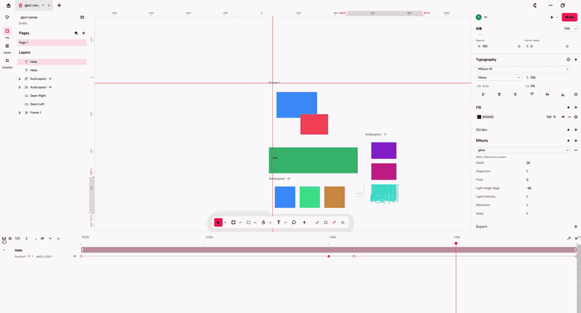
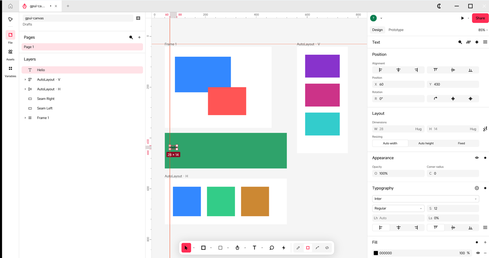
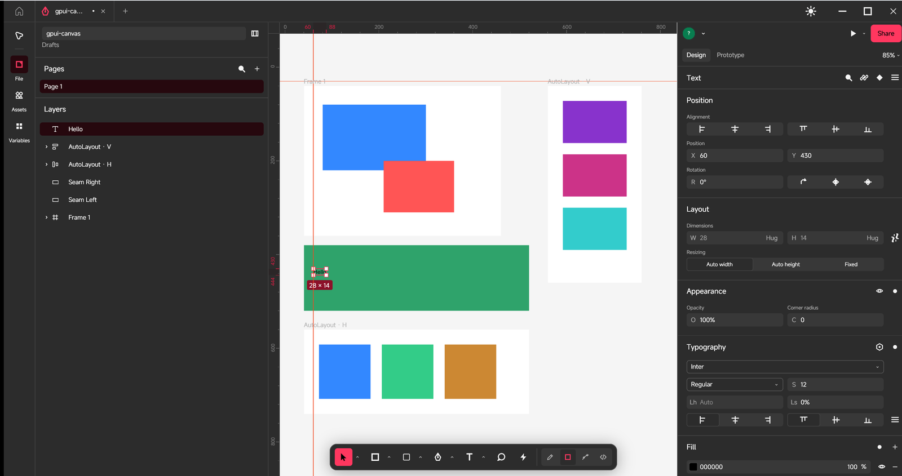
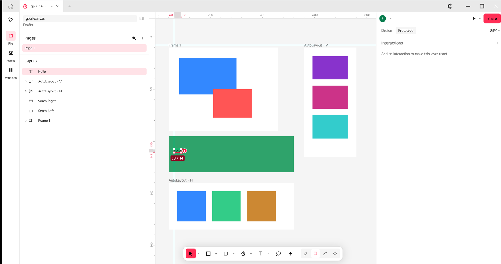
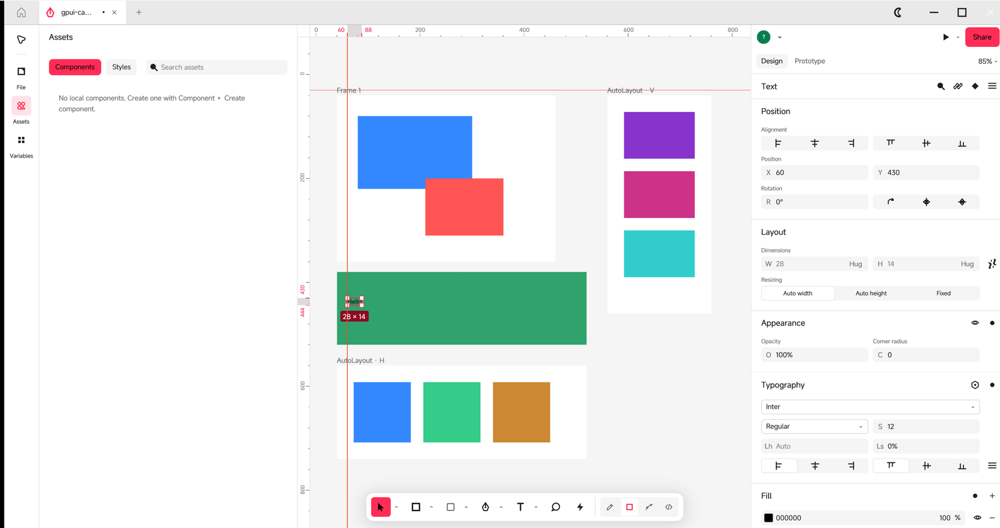
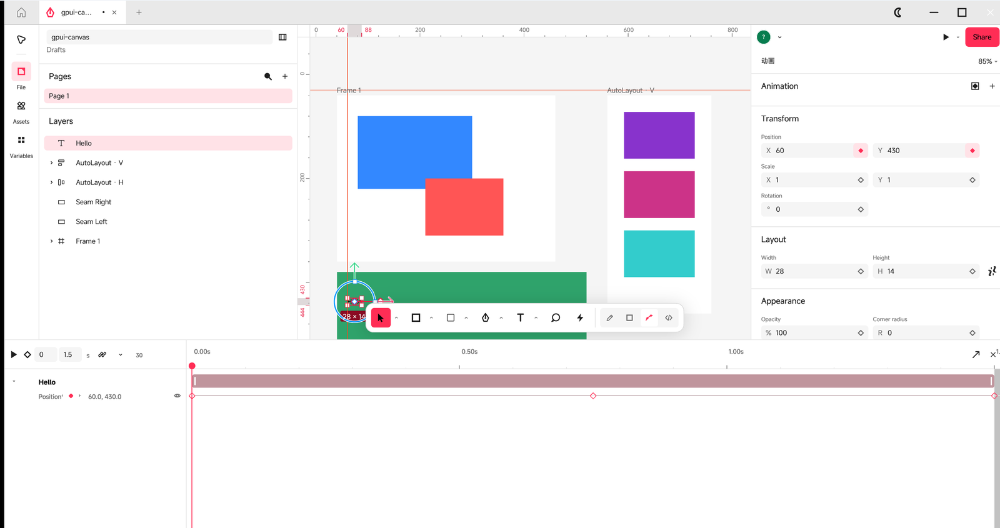
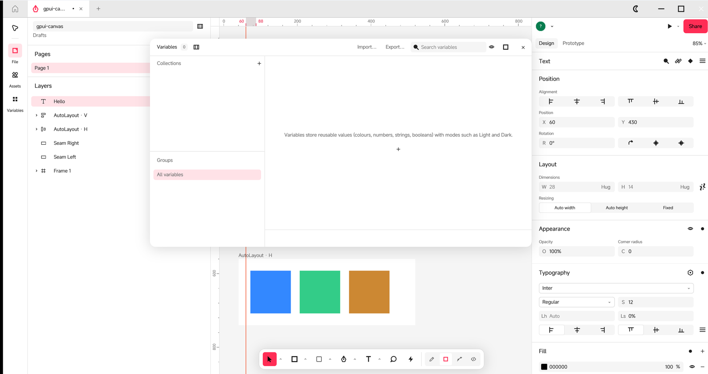

<p align="center">
  
</p>

<h1 align="center">Monet</h1>

<p align="center">
  <b>Designing a design tool is itself a design.</b><br>
  Frames, auto layout, components and variants, vector networks, styles, variables and prototypes,
  in an application that opens instantly and works offline.
</p>

<p align="center">
  <a href="README.zh-CN.md">中文</a> ·
  
  
  
  
</p>

<p align="center">
  
  <br><sub>One full animation cycle: a Glass effect in the Design panel, driven by keyframes on the Motion timeline.</sub>
</p>

---

## What this is

Monet is a desktop design tool written entirely in Rust. It has two layers:

- **A document engine** — a scene graph with layout, vector networks, text, components, styles,
  variables, prototyping, motion and a renderer. Files are local; opening one never needs an
  account or a network round trip.
- **A GPUI front end** — the panels, canvas, popovers, menus, dialogs and timeline you interact
  with. The original front end was built with egui, an immediate-mode toolkit that rebuilt the
  whole interface every frame. Monet rebuilds it with **GPUI**, Zed's retained-mode, GPU-composited
  framework: a declarative element tree, persistent widget state, taffy layout, and one render
  tree shared by panels, popovers and the canvas.

The port is deliberately **one for one**: panel order, control sizes, menu rows, keyboard paths and
dialog behaviour are checked against the egui implementation rather than re-invented. The egui
front end stays in the repository as the reference;
[`docs/gpui-egui-parity-plan.md`](docs/gpui-egui-parity-plan.md) and
[`docs/ui-inventory.md`](docs/ui-inventory.md) record what is matched and what still differs.

## Screenshots

Every image below is a capture of the running application (not a mockup).

| | |
|---|---|
|  |  |
| *Design canvas, light theme — layers, auto layouts and the properties inspector.* | *The same document in dark theme; the document colours stay untouched.* |
|  |  |
| *Prototype panel: flows, interactions and smart animate settings.* | *Dev Mode: inspect, measurements and hand-off information.* |
|  |  |
| *Assets: local components and styles, with search.* | *Motion: one track per animated property, with a looping clip and keyframes.* |
|  | |
| *Variables: collections, groups and modes in a floating, draggable table.* | |

## Highlights

### A real design canvas

- Frames, nested auto layout (horizontal, vertical and wrap), absolute positioning, constraints,
  rulers, guides, pixel grid and layout grids.
- Vector networks (pen, node editing, boolean operations) and paths; a brush engine that stamps
  external `.abr` brushes and keeps the document as editable paths.
- Text with fonts from the system catalogue, styles, and per-character runs.
- Components, instances, overrides and variants; local component and style libraries.
- Colour styles, variables with modes, and bindings from layer properties to variables.
- Prototype flows, interactions, conditional actions and a full-screen presentation player.

### Motion, not an afterthought

The timeline sits under the canvas. A frame owns one timeline, so every layer inside it shares the
same playhead, duration and clip — the tool animates a composition, not isolated objects. You get
keyframes, easing (including spatial Bezier handles), loops, and a clip inspector opened from the
clip itself or from the keyframe segment. Export renders the same engine evaluation to GIF, WebM
(AV1) or a zip of PNG frames with `motion.export`.

### Dev Mode and hand-off

Inspect a layer's geometry, typography, fills, strokes, effects and export settings, add
measurements, compare against a saved version, and read the values a developer needs. The right
panel switches between Design, Prototype and Inspect; Dev Mode is a keyboard shortcut away.

### Built for keyboard and for everyone

Every engine command is reachable through one code path — menus, shortcuts, the actions palette,
the CLI, MCP and the local control channel all call the same command specs. Menus share one set of
row metrics; focus order, keyboard navigation and screen-reader roles live in the widget layer.
The UI follows the system language, with translations managed in [`docs/translating.md`](docs/translating.md).

### Offline, local-first, scriptable

No sign-in, no server requirement, no remote document store. For automation, start the app with
`--control 7811` and drive it over the local control channel (`ui.inspect`, `engine.execute`,
`ui.pointer`, `ui.key`). The protocol is documented in
[`docs/control-protocol.md`](docs/control-protocol.md). The CLI and MCP server use the same engine
commands; see [`docs/cli.md`](docs/cli.md) and [`docs/mcp.md`](docs/mcp.md).

## Architecture

```
crates/
  doc/ geom/ color/ text/ pathops/ svg/ layout/ render/ format/     document engine and renderers
  engine/                       command specs, session, history, tools, animation
  abr/                          external Photoshop brush import
  collab/ collab-net/           collaboration primitives and transport
  i18n/                         localisation catalogue
  ui-gpui/                      the GPUI front end developed here
  ui-egui/                      original front end, kept as the 1:1 reference (excluded from builds)
  mcp/ plugin/ pdf/             Model Context Protocol, plugin SDK, PDF export
apps/
  figcraft-cli/                 command-line front end
  figcraft-server/              optional self-hosted server
```

The engine never depends on a UI toolkit. A command such as `motion.export` or `view.zoomFit` has a
single implementation in `crates/engine`, and every front end calls it. That is what makes the
egui/GPUI comparison meaningful: the two UIs share one document, one command surface and one set of
tests.

## Building and running

A recent stable Rust toolchain is required (edition 2024, MSRV 1.95); on Windows the MSVC
toolchain is expected.

```sh
cargo run -p figcraft-ui-gpui --example run
```

Run the GPUI UI tests:

```sh
cargo test -p figcraft-ui-gpui --lib --features test-support
```

To automate the running app, add `-- --control 7811` to the launch command and connect to
`127.0.0.1:7811`. Packaging and release steps are in [`docs/releasing.md`](docs/releasing.md).

## Contributing

Every change lands through a pull request; `main` is protected and CI must pass. UI work follows
the parity rule: copy the egui reference's controls, order, dimensions and behaviour, then add or
update the parity contract so a simplification cannot pass review. See
[`CONTRIBUTING.md`](CONTRIBUTING.md) and [`AGENTS.md`](AGENTS.md) for the review flow and the
non-negotiables. Automated review is provided by CodeRabbit.

## Documentation

- [Architecture](docs/architecture.md) — why the engine and the UI are separated.
- [GPUI ↔ egui parity plan](docs/gpui-egui-parity-plan.md) — the port's item-by-item status.
- [UI inventory](docs/ui-inventory.md) — 1,016 rows mapping interface elements to commands and source files.
- [Monet vs upstream FigCraft](docs/monet-upstream-diff.md) — which engine features were brought in and which are local.
- [File-format parity](docs/file-format-parity.md), [control protocol](docs/control-protocol.md),
  [CLI](docs/cli.md), [MCP](docs/mcp.md).

## Credits

The app icon is the owner's chameleon drawing, vectorised and rendered into every platform size by
`cargo xtask icon`. Third-party components and their licences are listed in
[`ATTRIBUTION.md`](ATTRIBUTION.md); contributors are listed in
[`docs/contributors.md`](docs/contributors.md).

## License

MIT OR Apache-2.0, at your option.
