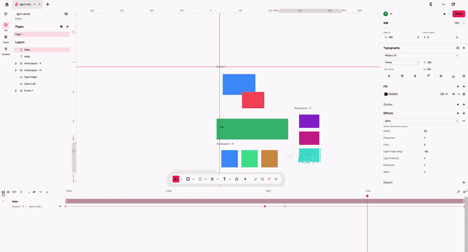
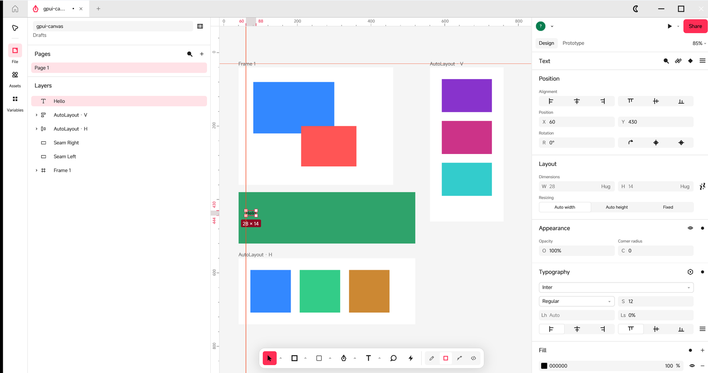
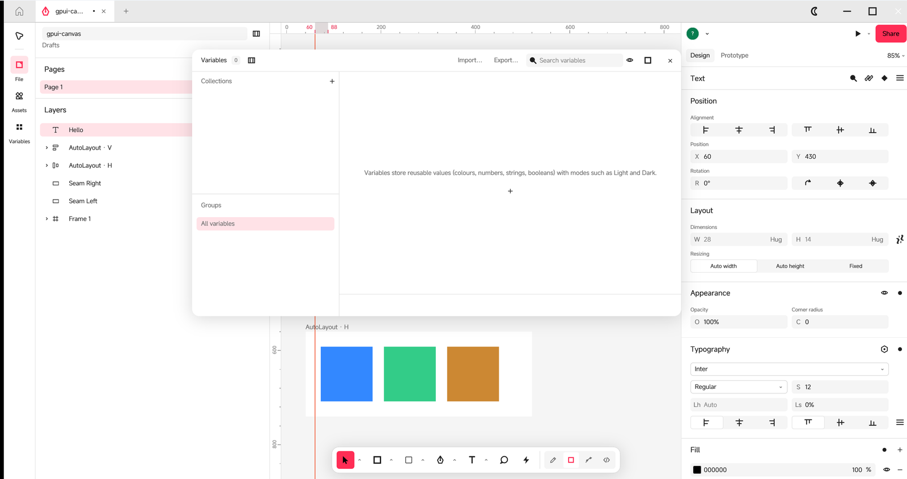

<p align="center">
  
</p>

<h1 align="center">Monet</h1>

<p align="center">
  <b>设计一个设计工具，本身就是一次设计。</b><br>
  画框、自动布局、组件与变体、矢量网络、样式、变量和原型——<br>
  一个秒开、离线可用、数据全在本地的设计软件。
</p>

<p align="center">
  <a href="README.md">English</a> ·
  
  
  
  
</p>

<p align="center">
  
  <br><sub>一个完整的动画周期：Design 面板里的玻璃效果，由 Motion 时间轴上的关键帧驱动。</sub>
</p>

---

## 这是什么

Monet 是一个完全用 Rust 写的桌面设计工具，分两层：

- **文档引擎**：场景图、布局、矢量网络、文字、组件、样式、变量、原型、动画，以及渲染器。
  文件存在本地，打开文档不需要账号，也不需要联网。
- **GPUI 前端**：你看到的面板、画布、浮层、菜单、对话框和时间轴。最初的前端是用 egui
  （立即模式工具库，每帧重建整个界面）写的；Monet 用 Zed 的 **GPUI**（保留模式、GPU 合成）
  重建了它：声明式元素树、持久控件状态、taffy 布局，面板、浮层和画布共用一棵渲染树。

移植坚持**一比一**：面板顺序、控件尺寸、菜单行高、键盘路径和对话框行为都对照 egui 实现核对，
而不是另起炉灶。egui 前端留在仓库里作为参照；
[`docs/gpui-egui-parity-plan.md`](docs/gpui-egui-parity-plan.md) 和
[`docs/ui-inventory.md`](docs/ui-inventory.md) 记录了已对齐与仍有差异的部分。

## 界面截图

下面每张图都是运行中的软件实拍，不是效果图。

| | |
|---|---|
|  |  |
| *设计画布（浅色）：图层树、自动布局与右侧属性检查器。* | *同一份文档的深色主题；文档自身的颜色不受主题影响。* |
|  |  |
| *原型面板：流程、交互与智能动画设置。* | *开发模式：检查、测量与交付信息。* |
|  |  |
| *Assets：本地组件与样式，带搜索。* | *Motion：每个可动画属性一条轨道，片段循环，关键帧可见。* |
|  | |
| *Variables：集合、分组与模式，位于可拖动的浮动窗口中。* | |

## 功能亮点

### 真正的设计画布

- 画框、嵌套自动布局（横向、纵向、Wrap）、绝对定位、约束、标尺、参考线、像素网格和布局网格。
- 矢量网络（钢笔、节点编辑、布尔运算）与路径；笔刷引擎盖章外部 `.abr` 笔刷，
  文档里仍保留可编辑路径。
- 使用系统字体目录的文字、文字样式与逐字符属性。
- 组件、实例、覆写与变体；本地组件和样式库。
- 颜色样式、带模式的变量，以及图层属性到变量的绑定。
- 原型流程、交互、条件动作，以及全屏演示播放器。

### 动画不是附加功能

时间轴停靠在画布下方。一个画框拥有一条时间轴，框内所有图层共用同一个播放头、时长和片段——
动画针对的是一幅合成画面，而不是彼此孤立的对象。关键帧、缓动（含空间贝塞尔手柄）、循环、
片段检查器（从片段本身或关键帧区间打开）一应俱全。导出时由同一套引擎求值生成 GIF、
WebM（AV1）或 PNG 帧压缩包，统一走 `motion.export` 命令。

### 开发模式与交付

检查图层的几何、字体、填充、描边、效果和导出设置，添加测量标注，与已保存版本对比，
读取开发者需要的数值。右侧面板在 Design、Prototype、Inspect 之间切换，开发模式有快捷键。

### 为键盘和所有人设计

所有引擎命令只有一条实现路径——菜单、快捷键、动作面板、CLI、MCP 和本地控制通道调用的是
同一批命令规格。菜单共用一套行高与墨色；焦点顺序、键盘导航和读屏角色属于控件层，
而不是事后补丁。界面跟随系统语言，翻译维护在 [`docs/translating.md`](docs/translating.md)。

### 离线、本地优先、可脚本化

无需登录、无需服务器、没有远程文档库。需要自动化时，用 `--control 7811` 启动软件，
通过本地控制通道驱动（`ui.inspect`、`engine.execute`、`ui.pointer`、`ui.key`）。
协议见 [`docs/control-protocol.md`](docs/control-protocol.md)。CLI 和 MCP 服务复用同一批引擎命令，
分别见 [`docs/cli.md`](docs/cli.md) 与 [`docs/mcp.md`](docs/mcp.md)。

## 架构

```
crates/
  doc/ geom/ color/ text/ pathops/ svg/ layout/ render/ format/     文档引擎与渲染器
  engine/                       命令规格、会话、历史、工具、动画
  abr/                          外部 Photoshop 笔刷导入
  collab/ collab-net/           协作原语与传输
  i18n/                         本地化目录
  ui-gpui/                      本项目开发的 GPUI 前端
  ui-egui/                      原前端，作为一比一参照保留（不参与编译）
  mcp/ plugin/ pdf/             Model Context Protocol、插件 SDK、PDF 导出
apps/
  figcraft-cli/                 命令行前端
  figcraft-server/              可选的自托管服务
```

引擎不依赖任何 UI 工具库。`motion.export`、`view.zoomFit` 这样的命令在 `crates/engine`
里只有一份实现，所有前端都调用它。这正是 egui / GPUI 对照能成立的原因：两套 UI 共享同一份
文档、同一套命令和同一批测试。

## 构建与运行

需要较新的稳定版 Rust 工具链（edition 2024，最低 1.95）；Windows 上使用 MSVC 工具链。

```sh
cargo run -p figcraft-ui-gpui --example run
```

运行 GPUI 界面测试：

```sh
cargo test -p figcraft-ui-gpui --lib --features test-support
```

要让运行中的软件接受自动化，启动时加上 `-- --control 7811`，再连接 `127.0.0.1:7811`。
打包与发布步骤见 [`docs/releasing.md`](docs/releasing.md)。

## 参与开发

所有改动都通过 PR 合入；`main` 受保护，CI 必须通过。界面改动遵守一比一规则：
照抄 egui 参照实现的控件、顺序、尺寸和行为，再更新 parity 契约，防止简化实现蒙混过关。
审阅流程和不可妥协项见 [`CONTRIBUTING.md`](CONTRIBUTING.md) 与 [`AGENTS.md`](AGENTS.md)。
自动审阅由 CodeRabbit 承担。

## 文档

- [架构](docs/architecture.md)——引擎与 UI 为什么分开。
- [GPUI ↔ egui 对齐计划](docs/gpui-egui-parity-plan.md)——移植逐项状态。
- [UI 清单](docs/ui-inventory.md)——1,016 行，把界面元素映射到命令和源文件。
- [Monet 与上游 FigCraft 差异](docs/monet-upstream-diff.md)——带入了哪些引擎特性，哪些是本地独有。
- [文件格式对照](docs/file-format-parity.md)、[控制协议](docs/control-protocol.md)、
  [CLI](docs/cli.md)、[MCP](docs/mcp.md)。

## 致谢

应用图标是项目所有者的变色龙手绘原稿，经矢量化后由 `cargo xtask icon` 渲染出各平台尺寸。
第三方组件及其许可见 [`ATTRIBUTION.md`](ATTRIBUTION.md)，贡献者见
[`docs/contributors.md`](docs/contributors.md)。

## 许可

MIT OR Apache-2.0，任选其一。
