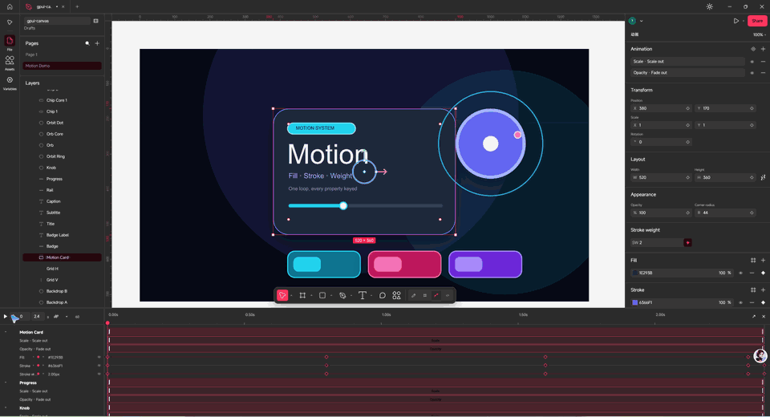
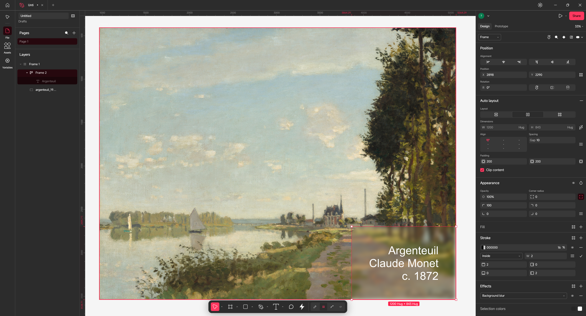
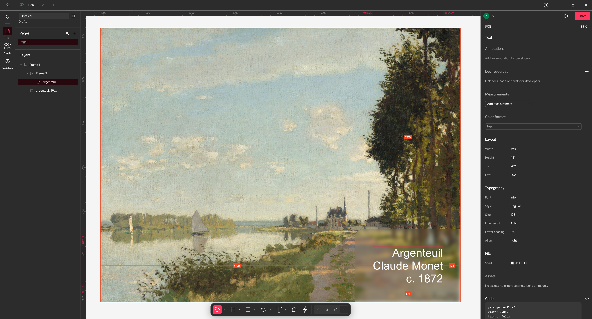
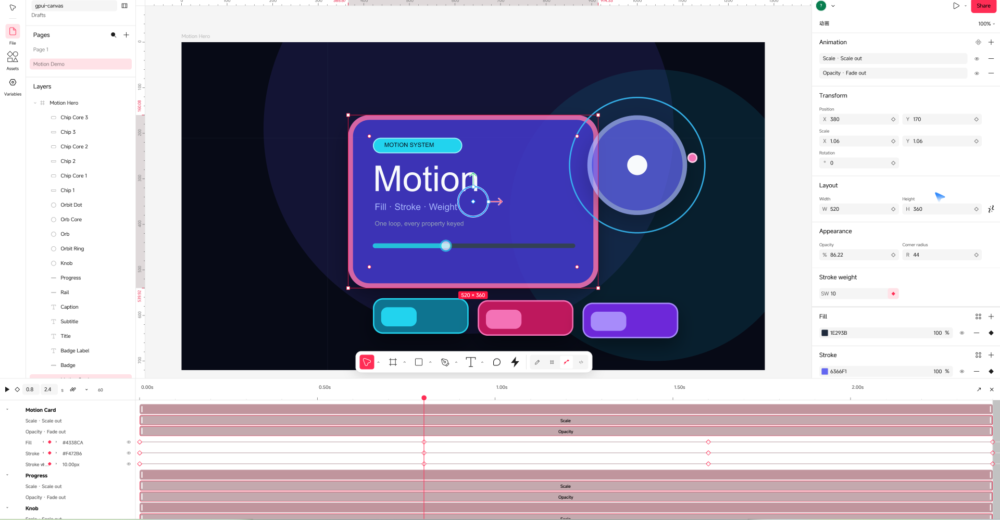
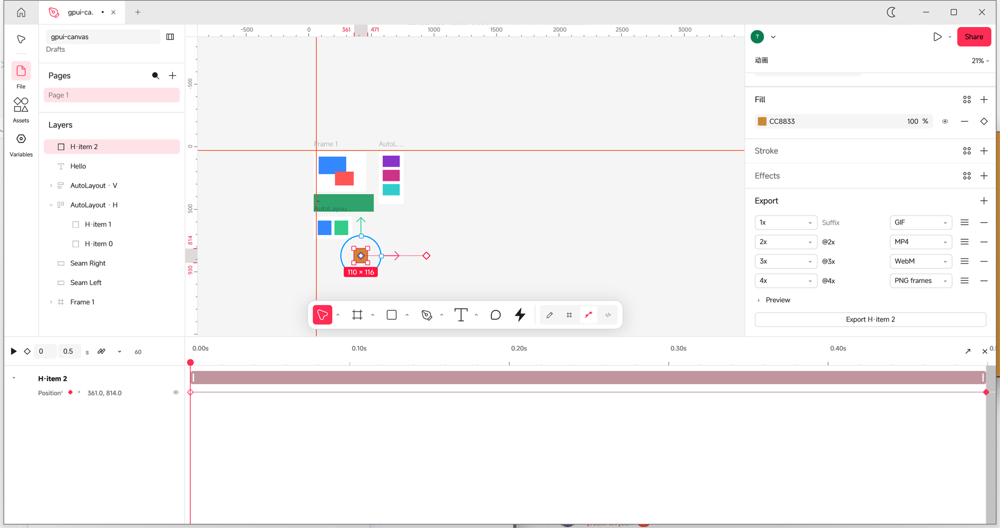
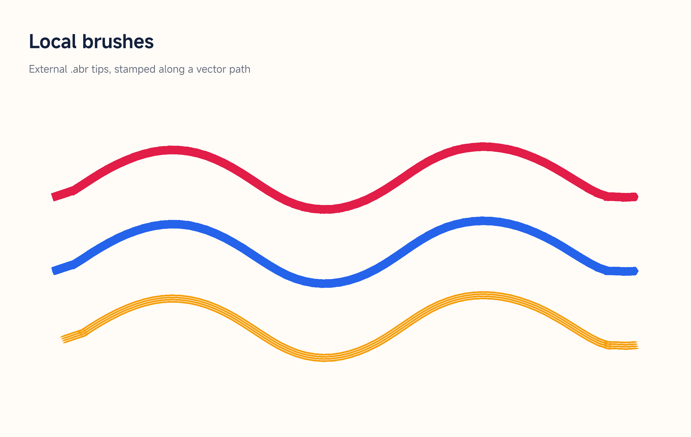
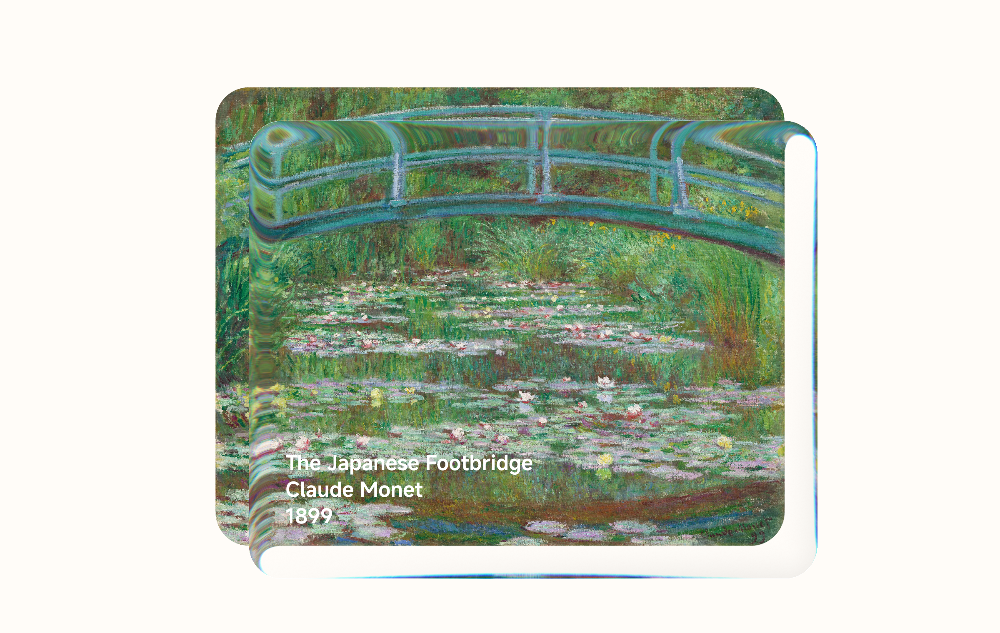

<p align="center">
  
</p>

<h1 align="center">Monet</h1>

<p align="center">
  <b>用 GPUI 构建的原生设计工具前端。</b><br>
  画框、自动布局、组件与变体、矢量网络、样式、变量和原型，<br>
  加上动画时间轴——由 Rust 文档引擎驱动，离线即可打开使用。
</p>

<p align="center">
  <a href="README.md">English</a> · <a href="README.zh-CN.md">中文</a>
</p>

<p align="center">
  
  
  
  
  <br>
  <a href="https://sonarcloud.io/project/overview?id=MonetDesigns_Monet"></a>
  <a href="https://coderabbit.ai"></a>
</p>

<br>

> [!NOTE]
> **本项目是 GPUI 前端。** 文档引擎与最初的 egui 前端在上游项目
> **[storytold/figcraft](https://github.com/storytold/figcraft)** 开发。引擎改动请提到上游，
> 本仓库只接收 GPUI 界面改动。详见 [CONTRIBUTING.md](CONTRIBUTING.md)。

<p align="center">
  <a href="#a-look-around">界面一览</a> ·
  <a href="#what-this-is">这是什么</a> ·
  <a href="#features">特性</a> ·
  <a href="#设备原型也是外置文件">设备原型</a> ·
  <a href="#get-started">开始使用</a> ·
  <a href="#contributing">参与贡献</a>
</p>

<br>

<p align="center">
  <a href="docs/images/motion-hero.mp4"></a>
</p>
<p align="center"><sub><b>2.4 秒动画循环，录自正在运行的 GPUI 编辑器</b> —— 填充、描边和描边线宽与预设片段写在同一条时间轴上。<a href="docs/images/motion-hero.mp4">引擎渲染的 MP4</a>，或<a href="docs/images/screenshots/08-motion-fill-stroke-weight.png">0.8 秒处的编辑器状态</a>。</sub></p>

## 界面一览

以下截图均来自运行中的 GPUI 应用（`cargo run -p figcraft-ui-gpui --example run`）。

<table>
<tr>
<td width="50%" valign="top">
  
  <p align="center"><sub><b>设计面板 · 浅色主题</b>：图层、画布与自动布局属性</sub></p>
</td>
<td width="50%" valign="top">
  
  <p align="center"><sub><b>深色主题</b>：同一文档，界面换肤</sub></p>
</td>
</tr>
<tr>
<td width="50%" valign="top">
  
  <p align="center"><sub><b>资产库</b>：组件与样式</sub></p>
</td>
<td width="50%" valign="top">
  
  <p align="center"><sub><b>开发者模式</b>：检查与交付控件</sub></p>
</td>
</tr>
<tr>
<td width="50%" valign="top">
  
  <p align="center"><sub><b>动画</b>：填充、描边和线宽自动关键帧</sub></p>
</td>
<td width="50%" valign="top">
  
  <p align="center"><sub><b>变量</b>：集合与模式</sub></p>
</td>
</tr>
</table>

<p align="center">
  
  <br>
  <sub><b>唯一的导出面</b> —— 导出跟着选择走：每个导出项保留自己的尺寸、后缀、格式、Dots 设置和删除；<code>+</code> 加一项，<code>-</code> 删一项。GIF、WebM、<code>PNG frames</code>、MP4 就是列表里的普通格式，一颗 Export 按钮会导出选中层的所有项。动画 FPS 不再占行内第四列，而是和 PNG frames 的 PNG 设置一起收在行尾 Dots 弹窗里。选中画框会导出整个画框子树；<code>PNG frames</code> 是逐帧 PNG 打成的 <code>.zip</code>。没有第二个对话框，也没有额外的动画开关。</sub>
</p>

## 这是什么

Monet 是一个桌面设计工具前端。下半部分是文档引擎：场景图、布局、矢量网络、文本、组件、
变量与原型；上半部分是驱动这个引擎的界面。

引擎最初的前端用 **egui**（立即模式工具库）编写。本仓库把这个前端移植到 **GPUI**——Zed 背后的
保留模式、GPU 合成框架：声明式元素树、持久状态、taffy 布局，面板、浮层与画布合成为一个 GPU 场景。

移植刻意保持一一对应：每个面板、对话框、浮层、菜单和键盘路径都按 egui 前端的布局、尺寸和
行为重建，[`docs/gpui-egui-parity-plan.md`](docs/gpui-egui-parity-plan.md) 记录仍有差异之处。
egui 前端作为冻结参照保留在仓库中；引擎改动在上游进行，不在本仓库。

## 特性

<table>
  <tr>
    <td width="50%" valign="top">
      <h3>🎛️ 单一 GPU 场景</h3>
      面板、浮层、浮动工具栏和画布共享同一棵渲染树，重叠菜单、拖拽预览和动画时间轴按屏幕上的
      顺序合成。
    </td>
    <td width="50%" valign="top">
      <h3>⚡ 流畅画布</h3>
      大文档下平移、缩放和选择依然跟手。图块在 UI 线程之外栅格化并流式载入，先显示低分辨率概览。
    </td>
  </tr>
  <tr>
    <td width="50%" valign="top">
      <h3>🧱 引擎支撑的编辑</h3>
      自动布局、组件实例与覆盖、样式、变量与模式、布尔运算、矢量网络、原型和画板都在引擎里，
      与上游项目共享。
    </td>
    <td width="50%" valign="top">
      <h3>🎬 引擎驱动的动画</h3>
      关键帧、缓动和按属性分轨驱动画布上的同一个场景。填充、描边和描边线宽可在检查器里自动
      打关键帧，预设覆盖入场、循环和出场，时间轴从右侧同一个 Export 节在后台导出
      <b>MP4（H.264）</b>、GIF、WebM（AV1）和逐帧 PNG 的 <code>.zip</code>。
    </td>
  </tr>
  <tr>
    <td width="50%" valign="top">
      <h3>🖌️ 本地笔刷</h3>
      笔刷是导入到本地库的外部 <code>.abr</code> 文件；笔画保留笔尖的柔和边缘，沿路径盖章绘制。
    </td>
    <td width="50%" valign="top">
      <h3>🧪 外置 WGSL 材质</h3>
      把图层指向一个 <code>.wgsl</code> 文件，或用 <code>FIGCRAFT_WGSL_DIR</code> 扫描目录。
      Shader 以图层像素为输入，在画布图块上做离屏 pass；uniform 会作为带标签的字段出现在效果
      面板，绑定随文档一起保存。
    </td>
  </tr>
  <tr>
    <td width="50%" valign="top">
      <h3>🔒 离线、本地优先</h3>
      无需账号、服务器，打开文件不需要网络往返。界面跟随系统语言，所有文案来自文案目录。
    </td>
    <td width="50%" valign="top">
      <h3>📦 可携带文件</h3>
      文档保存为 <code>.figcraft</code>；同一个引擎导出 PNG、SVG、WebM 和 PDF，开发插件从本地
      <code>figcraft-plugin.json</code> 清单加载。
    </td>
  </tr>
</table>

### 外置笔刷和材质

#### 笔刷是外置 `.abr` 文件

笔刷引擎不是一组固定的内置笔尖：它在运行时导入 `.abr` 笔刷库，笔画可以沿矢量路径盖章任意
笔尖，并支持间距、抖动、散布和独立随机种子。下面三条笔画使用随仓库附带的
`monet-defaults.abr` 笔刷库。

<p align="center">
  
  <br>
  <sub><b>本地笔刷</b> —— 来自外部 <code>.abr</code> 文件的 ribbon、ink 和 bristle 笔尖。</sub>
</p>

**笔刷文件放在哪里**

- 仓库和安装包自带一份出厂库：`assets/brushes/monet-defaults.abr`。桌面壳第一次启动会把它复制到用户笔刷目录，之后不再覆盖用户改过的文件。
- Windows 用户库：`%APPDATA%\Monet\brushes`。
- Linux 和 macOS 用户库：`$HOME/.local/share/monet/brushes`。
- 想让 Monet 只读另一个目录时，设置 `MONET_BRUSHES_DIR`；设置后就不再扫描默认用户库。
- 在笔刷面板点 Import，或执行 `brush.import {"path": "...\\xxx.abr"}`；也可以把 `.abr` 直接拖进用户库，再执行 `brush.reload`。
- `.figcraft` 只记录笔画的笔刷 preset id，不复制 `.abr` 文件。把设计文件换到另一台机器时，要同时把同一个 `.abr` 放进那台机器的用户库，否则笔画会回退成普通描边。

#### 材质是外置 `.wgsl` 文件

WGSL 材质在 shader 层同理：图层绑定记录一个 `.wgsl` 文件及其 uniform 值；画布把这个节点从
CPU 图块里挖空，用背后的像素运行 shader，再把结果合成回来。下面的天气卡片是一个玻璃材质，
采样它下方的彩色背景。

<p align="center">
  
  <br>
  <sub><b>外置 WGSL 材质</b> —— 覆盖在实时画布图块上的玻璃 shader，uniform 在效果面板中可调。</sub>
</p>

**材质文件放在哪里**

- 与 Monet 可执行文件同级：`<Monet.exe 所在目录>/assets/wgsl/`。安装包已经带 `glass.wgsl`，这是最省事的位置。
- 项目或工作目录下：`<当前工作目录>/assets/wgsl/`。从源码运行时，Monet 会优先找这里。
- 任意目录：设置 `FIGCRAFT_WGSL_DIR` 指向该目录，效果面板的材质下拉就会扫描它。
- 图层绑定保存的是 `.wgsl` 的路径字符串，不是 shader 源码；`.figcraft` 不会把 shader 打进文件。换机器时把 `.wgsl` 放到相同的 `assets/wgsl/` 位置，或在效果面板里重新选一次文件。

### 设备原型也是外置文件

Monet 不把设备清单编译进二进制。原型（Prototype）面板读取用户目录里的 `devices.json` 和
每一张机身 PNG：

- 设置了 `MONET_DEVICES_DIR` 时用它；
- Windows 默认 `%APPDATA%\Monet\devices`；
- Linux 和 macOS 默认 `$HOME/.local/share/monet/devices`。

桌面壳首次启动会把 `assets/devices` 里的出厂目录复制进去，之后每次启动只刷新有变化的文件。
此后引擎的每个系列、型号、颜色和机身 PNG 都从该目录读取；`MONET_DEVICES_DIR` 可指向另一个
目录。随仓库附带的目录有 13 个系列、25 个型号、90 种型号/颜色组合、155 张机身 PNG
（约 106 MB），覆盖 iPhone 16/17/18、iPhone Duo，iPad、iPad mini/Air/Pro，
MacBook Air/Neo/Pro/Pro XDR 和 iMac。

`devices.json` 当前是 version 2。一个 family 有 `id` 和显示名 `name`；它的 variants 带一张
`frame` 映射（方向 → 颜色 → 相对设备目录的 PNG 路径）、逻辑屏幕的 `width` 和 `height`、
`rotates`、`kind`、可选 `colors`，以及按 PNG 像素测量的 `screenRects`、`screenRadius` 和
`outerRadius`。引擎靠这些字段把原型画面嵌进新机身：几何是数据，不是代码。
原型设置面板先选 family 下拉，再在型号 flyout 里选具体机型，然后选颜色和竖屏/横屏；
只有 `rotates` 为 true 的设备才显示旋转。清单和加载逻辑分别在
[`assets/devices/devices.json`](assets/devices/devices.json) 和
[`crates/devices/src/lib.rs`](crates/devices/src/lib.rs)。

## 开始使用

需要较新的稳定版 Rust 工具链（edition 2024，`rust-version = 1.95`）。Windows 上需 MSVC 工具链。

```sh
cargo run -p figcraft-ui-gpui --example run
```

GPU 现在默认开启。外置 WGSL 材质既在画布上执行，也会按导出倍率烘进 PNG、JPG、WebP——玻璃卡片导出的就是玻璃，不再是它的平涂底色。只有显式关掉默认 feature 才是纯 CPU 构建（不执行 shader）：

```sh
cargo run -p figcraft-ui-gpui --example run                        # 默认 GPU
cargo run -p figcraft-ui-gpui --example run --no-default-features  # 纯 CPU
```

测试：

```sh
cargo test -p figcraft-ui-gpui --lib --features test-support
```

## 参与贡献

引擎与 egui 改动请提交到 **[storytold/figcraft](https://github.com/storytold/figcraft)**；
本仓库只接收 GPUI 前端改动。完整规则、一一对应要求和每个 PR 的检查项见
[CONTRIBUTING.md](CONTRIBUTING.md)。

与上游的差距记录在 [`docs/monet-upstream-diff.md`](docs/monet-upstream-diff.md)。

## 归属与许可

Monet 的 GPUI 前端是本仓库的原创工作。文档引擎与 egui 前端来自
[storytold/figcraft](https://github.com/storytold/figcraft)；第三方素材与署名见
[ATTRIBUTION.md](ATTRIBUTION.md)。

采用 [MIT](LICENSE-MIT) 或 [Apache-2.0](LICENSE-APACHE) 双许可，任选其一。
品牌素材另有条款，见 [`docs/brand/LICENSE-brand.txt`](docs/brand/LICENSE-brand.txt)。
