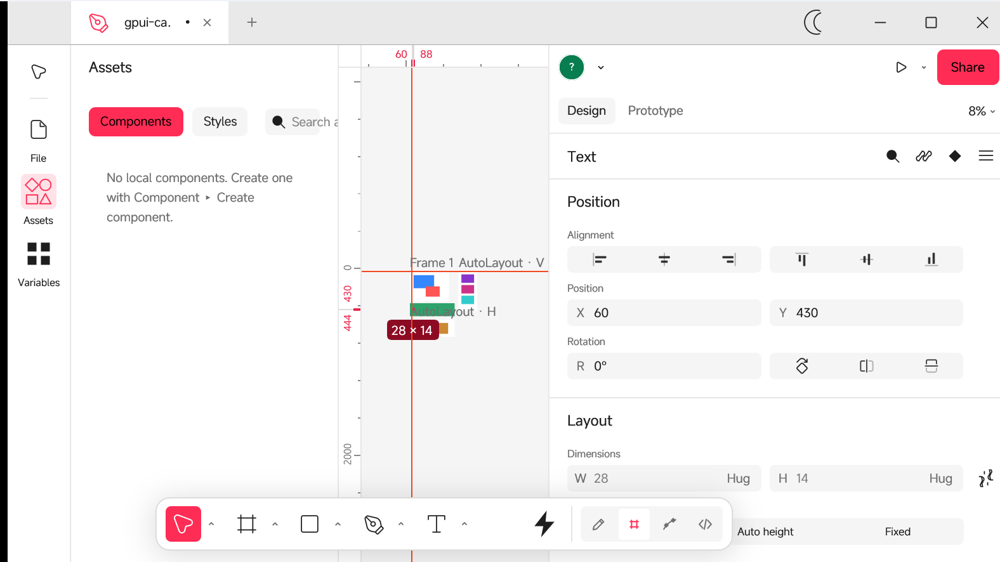

<p align="center">
  
</p>

<h1 align="center">Monet</h1>

<p align="center">
  <b>用 GPUI 构建的原生设计工具前端。</b><br>
  画框、自动布局、组件与变体、矢量网络、样式、变量和原型，<br>
  加上动画时间轴——由 Rust 文档引擎驱动，离线即可打开使用。
</p>

<p align="center">
  <a href="README.md">English</a> · <a href="README.zh-CN.md">中文</a>
</p>

<p align="center">
  
  
  
  
  <br>
  <a href="https://sonarcloud.io/project/overview?id=MonetDesigns_Monet"></a>
  <a href="https://coderabbit.ai"></a>
</p>

<br>

> [!NOTE]
> **本项目是 GPUI 前端。** 文档引擎与最初的 egui 前端在上游项目
> **[storytold/figcraft](https://github.com/storytold/figcraft)** 开发。引擎改动请提到上游，
> 本仓库只接收 GPUI 界面改动。详见 [CONTRIBUTING.md](CONTRIBUTING.md)。

<p align="center">
  <a href="#a-look-around">界面一览</a> ·
  <a href="#what-this-is">这是什么</a> ·
  <a href="#features">特性</a> ·
  <a href="#get-started">开始使用</a> ·
  <a href="#contributing">参与贡献</a>
</p>

<br>

## 界面一览

以下截图均来自运行中的 GPUI 应用（`cargo run -p figcraft-ui-gpui --example run`）。

<table>
<tr>
<td width="50%" valign="top">
  
  <p align="center"><sub><b>设计面板 · 浅色主题</b>：图层、画布与自动布局属性</sub></p>
</td>
<td width="50%" valign="top">
  
  <p align="center"><sub><b>深色主题</b>：同一文档，界面换肤</sub></p>
</td>
</tr>
<tr>
<td width="50%" valign="top">
  
  <p align="center"><sub><b>资产库</b>：组件与样式</sub></p>
</td>
<td width="50%" valign="top">
  
  <p align="center"><sub><b>开发者模式</b>：检查与交付控件</sub></p>
</td>
</tr>
<tr>
<td width="50%" valign="top">
  
  <p align="center"><sub><b>动画时间轴</b>：循环 Position 轨道上的关键帧</sub></p>
</td>
<td width="50%" valign="top">
  
  <p align="center"><sub><b>变量</b>：集合与模式</sub></p>
</td>
</tr>
</table>

## 这是什么

Monet 是一个桌面设计工具前端。下半部分是文档引擎：场景图、布局、矢量网络、文本、组件、
变量与原型；上半部分是驱动这个引擎的界面。

引擎最初的前端用 **egui**（立即模式工具库）编写。本仓库把这个前端移植到 **GPUI**——Zed 背后的
保留模式、GPU 合成框架：声明式元素树、持久状态、taffy 布局，面板、浮层与画布合成为一个 GPU 场景。

移植刻意保持一一对应：每个面板、对话框、浮层、菜单和键盘路径都按 egui 前端的布局、尺寸和
行为重建，[`docs/gpui-egui-parity-plan.md`](docs/gpui-egui-parity-plan.md) 记录仍有差异之处。
egui 前端作为冻结参照保留在仓库中；引擎改动在上游进行，不在本仓库。

## 特性

<table>
  <tr>
    <td width="50%" valign="top">
      <h3>🎛️ 单一 GPU 场景</h3>
      面板、浮层、浮动工具栏和画布共享同一棵渲染树，重叠菜单、拖拽预览和动画时间轴按屏幕上的
      顺序合成。
    </td>
    <td width="50%" valign="top">
      <h3>⚡ 流畅画布</h3>
      大文档下平移、缩放和选择依然跟手。图块在 UI 线程之外栅格化并流式载入，先显示低分辨率概览。
    </td>
  </tr>
  <tr>
    <td width="50%" valign="top">
      <h3>🧱 引擎支撑的编辑</h3>
      自动布局、组件实例与覆盖、样式、变量与模式、布尔运算、矢量网络、原型和画板都在引擎里，
      与上游项目共享。
    </td>
    <td width="50%" valign="top">
      <h3>🎬 动画</h3>
      关键帧、缓动和画布下方的时间轴驱动同一个场景，支持循环片段和按属性分轨。
    </td>
  </tr>
  <tr>
    <td width="50%" valign="top">
      <h3>🖌️ 本地笔刷</h3>
      笔刷是导入到本地库的外部 <code>.abr</code> 文件；笔画保留笔尖的柔和边缘，沿路径盖章绘制。
    </td>
    <td width="50%" valign="top">
      <h3>🔒 离线、本地优先</h3>
      无需账号、服务器，打开文件不需要网络往返。界面跟随系统语言，所有文案来自文案目录。
    </td>
  </tr>
</table>

## 开始使用

需要较新的稳定版 Rust 工具链（edition 2024，`rust-version = 1.95`）。Windows 上需 MSVC 工具链。

```sh
cargo run -p figcraft-ui-gpui --example run
```

测试：

```sh
cargo test -p figcraft-ui-gpui --lib --features test-support
```

## 参与贡献

引擎与 egui 改动请提交到 **[storytold/figcraft](https://github.com/storytold/figcraft)**；
本仓库只接收 GPUI 前端改动。完整规则、一一对应要求和每个 PR 的检查项见
[CONTRIBUTING.md](CONTRIBUTING.md)。

与上游的差距记录在 [`docs/monet-upstream-diff.md`](docs/monet-upstream-diff.md)。

## 归属与许可

Monet 的 GPUI 前端是本仓库的原创工作。文档引擎与 egui 前端来自
[storytold/figcraft](https://github.com/storytold/figcraft)；第三方素材与署名见
[ATTRIBUTION.md](ATTRIBUTION.md)。

采用 [MIT](LICENSE-MIT) 或 [Apache-2.0](LICENSE-APACHE) 双许可，任选其一。
品牌素材另有条款，见 [`docs/brand/LICENSE-brand.txt`](docs/brand/LICENSE-brand.txt)。
